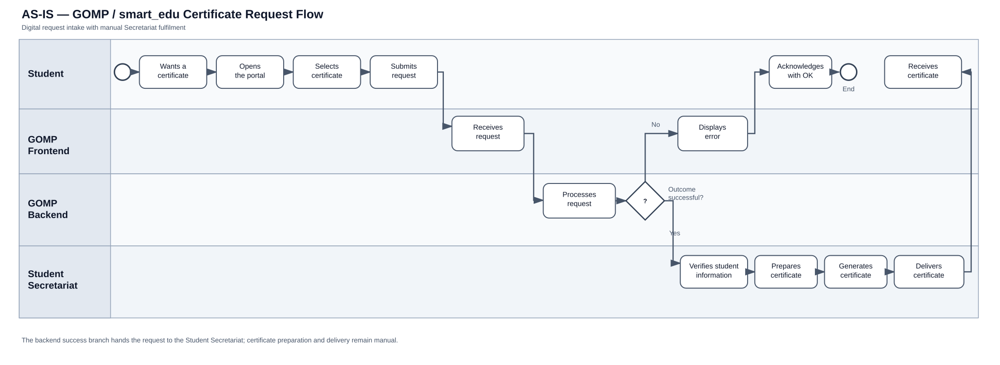

# 02 — AS-IS Process Analysis: University Certificate Issuance

> **Document owner:** Author-created process analysis.  
> **Scope:** AS-IS analysis of the manual and GOMP / smart_edu certificate-issuance flows, documented through the two BPMN diagrams included with this project.

## 1. Purpose and scope

This document describes the current-state (*AS-IS*) certificate-issuance process through two modeled variants:

1. **Manual certificate issuance** — a student requests a certificate and the Student Secretariat performs the processing steps.
2. **GOMP / smart_edu request flow with Secretariat fulfilment** — the request is initiated in the application, passed through the GOMP Frontend and Backend, and then routed to the Student Secretariat when processing succeeds. The diagram also models an error path.

The analysis covers the request journey, participant responsibilities, process controls, exception handling, operational risks, baseline metrics, and implications for a future *TO-BE* design. The BPMN models define the current process structure; the supporting requirements specify business rules, data, integrations, and operational controls.

## 2. Process at a glance

| Attribute | Manual variant | GOMP / smart_edu variant |
|---|---|---|
| Trigger | Student wants a certificate | Student wants a certificate and starts in the application |
| Student interaction | Chooses the needed certificate and submits a request | Opens the main screen, chooses a certificate, submits the request, and responds to an `OK` prompt or error message as modeled |
| Main processing participant | Student Secretariat | GOMP Frontend and Backend, followed by the Student Secretariat on the successful route |
| Verification and fulfilment | Verify student information, prepare certificate, generate certificate, deliver it | The same four Secretariat activities appear after the backend decision on the successful route |
| Exception handling shown | No explicit exception path | Backend decision: successful request proceeds; unsuccessful request triggers an error response |
| End state | Student receives the certificate | Student receives the certificate on the successful route |

## 3. Diagram A — Manual certificate issuance

**Source diagram:** [AS IS — Manual Certificate Issuance.svg](<./AS IS — Manual Certificate Issuance.svg>)

### 3.1 Participants and responsibilities

- **Student:** initiates the process, chooses the needed certificate, submits the request, and receives the certificate.
- **Student Secretariat:** receives the request, verifies student information, prepares the certificate, generates it, and delivers it to the student.

### 3.2 Main flow

1. The student wants a certificate.
2. The student chooses the needed certificate.
3. The student submits a certificate request.
4. The Student Secretariat receives the request.
5. The Secretariat verifies student information.
6. The Secretariat prepares the certificate.
7. The Secretariat generates the certificate.
8. The Secretariat delivers the certificate to the student.
9. The student receives the certificate and the process ends successfully.

### 3.3 Operational interpretation

The manual flow establishes a clear service sequence: request submission is followed by Secretariat verification, preparation, generation, and delivery. The main operational focus is the work performed after the request reaches the Secretariat. This is the baseline for assessing hand-offs, workload, service time, rework, and opportunities to streamline fulfilment in the TO-BE process.

## 4. Diagram B — GOMP / smart_edu request flow with Secretariat fulfilment

**Process diagram:** [GOMP / smart_edu request-flow diagram](./as-is-gomp-digital-request-flow.svg)

### 4.1 Participants and responsibilities

The model uses four swimlanes:

- **Student:** opens the main screen, chooses the certificate, submits the request, responds to the displayed `OK` step, and receives the certificate on the successful route.
- **GOMP Frontend:** receives the certificate request and displays an error in the unsuccessful route.
- **GOMP Backend:** processes the request and evaluates whether the certificate request process was successful. The modeled unsuccessful branch sends an error.
- **Student Secretariat:** receives the request for processing on the successful route, verifies student information, prepares the certificate, generates it, and delivers it to the student.

These are the responsibilities represented in the process model. Technical implementation details and integration contracts belong to the system requirements and design documentation.

### 4.2 Main flow — successful request

1. The student wants a certificate.
2. The student opens the application’s main screen.
3. The student chooses a certificate.
4. The student submits the certificate request.
5. The GOMP Frontend receives the request.
6. The GOMP Backend processes the request.
7. A gateway evaluates whether request processing was successful.
8. On the **yes** branch, the request is passed to the Student Secretariat for processing.
9. The Secretariat verifies student information.
10. The Secretariat prepares the certificate.
11. The Secretariat generates the certificate.
12. The Secretariat delivers the certificate to the student.
13. The student receives the certificate and the process reaches its successful end state.

### 4.3 Exception flow — unsuccessful request processing

1. The GOMP Backend processes the certificate request.
2. The gateway follows the **no** branch when the request-processing step is unsuccessful.
3. The backend sends an error.
4. The frontend displays an error to the student.
5. The diagram includes an `OK` interaction for the student.

**Process implication:** the modeled error path ends at the student's acknowledgement. The error-handling flow therefore needs a defined next state, such as correction and resubmission, retry, or termination, so users know how to proceed and failed requests remain traceable.

### 4.4 Important distinction

The diagram models automation of request intake and a backend success/failure decision, but it still routes successful requests to the Student Secretariat for verification, preparation, generation, and delivery. Therefore, the diagram supports describing the process as **digitally initiated and system-routed, with Secretariat fulfilment**. By itself, it does not demonstrate end-to-end automatic certificate generation or delivery.

## 5. Cross-variant analysis

### 5.1 Stable process core

Both diagrams share the same core fulfilment sequence:

**Receive request → Verify student information → Prepare certificate → Generate certificate → Deliver certificate → Student receives certificate.**

The key modeled difference is upstream of Secretariat fulfilment. The manual variant shows the student submitting a request directly to the Secretariat. The GOMP / smart_edu variant inserts a frontend, backend processing, a success/failure gateway, and a modeled error response before the successful request reaches the Secretariat.

### 5.2 Key findings and operational implications

| Finding from the process model | Operational implication | Analysis focus |
|---|---|---|
| Secretariat activities remain in both variants. | Digitized intake alone does not remove fulfilment workload. | Separate judgement-based work from repeatable, rule-based activities. |
| The GOMP / smart_edu variant includes a backend success/failure decision. | A control point determines whether the request proceeds to Secretariat fulfilment. | Define decision rules and map backend errors to actionable user messages. |
| The manual variant does not model a separate exception route. | Exception handling should be made explicit in the end-to-end process. | Define ownership and communication for incomplete, invalid, or ineligible requests. |
| The GOMP / smart_edu variant shows an error message and an `OK` interaction, without a subsequent recovery step. | The error journey needs an explicit next action and end state. | Specify whether users can correct, save, cancel, retry, or resubmit. |
| The models focus on workflow and hand-offs rather than operational performance data. | Combine BPMN analysis with process metrics to assess service performance. | Capture processing time, request volume, backlog, and rework rate. |
| Both diagrams end with certificate delivery and receipt; the delivery channel is not shown. | The delivery step should be specified consistently across the process and user journey. | Document the channel, format, and delivery confirmation. |

## 6. Process risks and improvement opportunities

The two modeled flows highlight the following operational risks and improvement opportunities:

1. **Repeated manual fulfilment steps.** Verification, preparation, generation, and delivery appear as Secretariat activities in both variants. Review these steps for manual data entry, duplicate checks, and avoidable hand-offs.
2. **Limited visibility into request status.** Neither diagram shows a status-tracking activity, queue state, or notification sequence. A consistent status model should make it possible to identify whether a request is received, in progress, blocked, or completed.
3. **Unspecified exception recovery.** The GOMP / smart_edu diagram ends its modeled error path at the acknowledgement interaction. Define a clear student recovery path and ensure failed requests remain traceable.
4. **Unspecified validation and eligibility rules.** The diagrams show verification of student information but not the data checked, the authoritative source, or the rules applied. Document the relevant rules and data sources before specifying validation automation.
5. **Unmeasured service performance.** No cycle times, waiting times, throughput, or rework data are shown. Use a measured baseline to quantify the effect of any redesigned process.

## 7. Risks and control requirements

| Control area | Current-state evidence | Control requirement |
|---|---|---|
| Request validation | A backend outcome decision in the GOMP / smart_edu variant; student-information verification by the Secretariat in both variants | Define validation rules, authoritative data sources, handling of missing or conflicting data, and audit trail. |
| Error handling | Backend error → frontend error display → student `OK` interaction | Establish an error taxonomy, actionable messages, recovery and resubmission behavior, logging, and ownership. |
| Responsibility | Student, GOMP Frontend, GOMP Backend, and Secretariat lanes in the GOMP / smart_edu variant | Assign operational ownership, escalation, and responsibility for stalled requests. |
| Certificate generation | A generation activity is assigned to the Secretariat lane | Specify generation tools, templates, quality checks, and controls against incorrect issuance. |
| Delivery | A delivery activity and student receipt are shown | Define the delivery channel, confirmation, failed-delivery handling, and record retention. |
| Measurement | Neither diagram includes performance metrics | Establish baseline KPIs and capture reliable event timestamps. |

## 8. Baseline metrics needed before a TO-BE proposal

Collect a representative sample of requests and measure at least:

- **End-to-end lead time:** request submission to certificate receipt.
- **Processing time:** active work time, separated from waiting time.
- **First-time-right rate:** percentage completed without correction or rework.
- **Exception rate:** percentage of requests that fail validation or require manual intervention.
- **Rework rate:** percentage returned for correction or processed more than once.
- **Request volume and backlog:** number received, completed, and pending per period.
- **Channel / variant split:** share of requests following each available route, if both routes operate in practice.
- **Error recovery rate:** percentage of failed digital requests successfully resolved, if this can be measured from system logs.

For each KPI, record the measurement period, sample size, calculation definition, and data source.

## 9. Questions for stakeholder interviews

### Student / service user
- How does a student discover and select the correct certificate type?
- What information or documents are required to submit a request?
- Is the request confirmation clear, and can the student track progress?
- What does the student see after an error, and what action can they take next?
- How and where is the completed certificate received?

### Student Secretariat
- Which fields and records are checked during verification?
- Which cases require manual judgement, approval, or additional documentation?
- What tools are used to prepare and generate a certificate?
- Where do delays, corrections, duplicate requests, or incomplete submissions most often occur?
- How are requests prioritized, assigned, escalated, and marked complete?

### Application / technical owner
- What exactly constitutes successful backend processing?
- Which errors can be returned, and how are they mapped to user-facing messages?
- Is a failed request persisted, logged, and linked to a traceable request ID?
- What happens after the student acknowledges the error?
- Which system is the source of truth for student data and certificate status?
- Which events and timestamps are available for baseline measurement?

## 10. Implications for TO-BE design

The TO-BE design should convert the findings above into measurable process and system requirements. Priority design areas are:

1. **Clear request status and notifications** across receipt, verification, processing, and delivery.
2. **Actionable error handling**, with understandable messages and an explicit recovery path.
3. **Rule-based validation** where the required data sources and business rules are confirmed.
4. **Reduced duplicate handling** through consistent request identifiers and traceability, if supported by the existing architecture.
5. **Standardized certificate preparation and generation** where policy permits automation and controls can be maintained.
6. **Operational monitoring** for volumes, processing times, exceptions, and backlog.

The TO-BE BPMN model should show the agreed exception paths, responsibility boundaries, system/user interactions, and end states. Each improvement should be tied to a baseline KPI so its impact can be evaluated after implementation.

## 11. Summary of current-state findings

The comparison establishes three principal findings:

1. **The main fulfilment sequence is consistent across both variants.** Secretariat verification, preparation, generation, and delivery remain central to the process.
2. **The digital variant changes request intake and routing.** GOMP Frontend and Backend processing, a success/failure decision, and an error response are added before successful Secretariat fulfilment.
3. **The highest-value TO-BE opportunities are operationally specific.** They are to make request status visible, define error recovery, formalize validation and responsibility, and measure end-to-end service performance.

The two BPMN diagrams provide the process structure for this analysis. The KPI baseline and detailed business rules should be documented alongside the process model so the future-state design can be assessed against a clear current-state reference.

## 12. Source diagrams

- [Manual certificate issuance BPMN](<./AS IS — Manual Certificate Issuance.svg>)
- [GOMP / smart_edu request flow with Secretariat fulfilment BPMN](./as-is-gomp-digital-request-flow.svg)

---

**Next artifact:** `04-to-be-process.md` — the TO-BE process design, translating these findings into target workflows, controls, and measurable outcomes.
