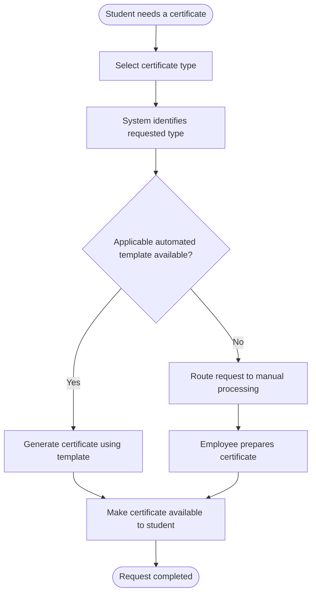

# Digital Certificates — AS-IS Process

**Model status:** Reconstructed hypothesis for portfolio use  
**Purpose:** Illustrate one plausible processing model consistent with the selected scenario.

## 1. Current-state hypothesis

The working hypothesis is that certificate requests followed one of two routes depending on whether the requested certificate type was supported by an automated template:

- **Automated route:** an available template can be matched to the requested type, allowing the document to be generated automatically.
- **Manual route:** no applicable automated template is available, so the request requires employee handling.

This decision rule is assumed for this portfolio case. The exact original routing logic has not been verified.

## 2. High-level process diagram

The diagram is a high-level process-flow illustration. It is not represented as a verified BPMN model of the original GOMP workflow.

## 3. Process steps in the reconstructed scenario

| Step | Actor / system | Activity | Expected output |
|---|---|---|---|
| 1 | Student | Selects the required certificate type | Request details |
| 2 | Platform | Identifies the requested type and checks template coverage | Routing decision |
| 3A | Platform | Uses a matching automated template | Generated certificate file |
| 3B | University staff | Handles the request manually when an applicable template is unavailable | Prepared certificate file |
| 4 | Platform / staff | Makes the completed certificate available to the student | Issued certificate |

The sequence and actors above are proposed for the case study and may differ from the original implementation.

## 4. Potential pain points under this hypothesis

- Certificate types outside automated-template coverage require manual handling.
- Employees spend time preparing documents that could potentially be standardized.
- The processing route depends on whether a suitable template exists.
- Different processing routes may lead to different turnaround times.

These are potential implications of the assumed process, not independently confirmed historical findings.

## 5. What an implementation-ready AS-IS model would require

Before this model could be treated as a validated current-state diagram, the analyst would confirm:

- The actual certificate types in scope
- The original routing decision and its rules
- The exact activities performed by the platform and by staff
- Handoffs, statuses, exceptions, and completion conditions
- Whether the manual route is triggered only by missing templates or by other conditions as well
