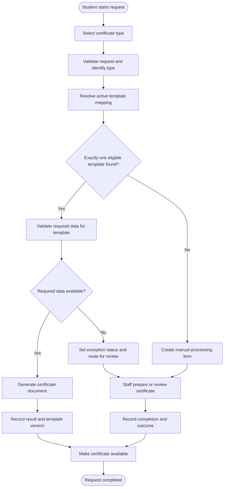

# Digital Certificates — TO-BE Process Proposal

**Status:** Proposed design for portfolio use; not a claim about the original implementation

## 1. Design goal

Make the certificate-processing route explicit, manageable, and traceable. Where an approved active template supports the requested certificate type, the platform should use the automated route. Where no applicable template exists, the request should follow a visible manual route rather than fail silently.

The long-term business goal is to expand automation coverage in a controlled way, based on a prioritized catalogue of certificate types.

## 2. Proposed process

The missing-template route is central to the chosen scenario. The data-validation branch is included as a proposed control to avoid generating a document with missing required information; it is not asserted as an original feature.

## 3. Proposed changes from AS-IS

| Area | Reconstructed AS-IS hypothesis | Proposed TO-BE |
|---|---|---|
| Template coverage | Coverage is assumed to be limited to selected types | Maintain an explicit catalogue and mapping between types and approved templates |
| Routing | Manual handling is assumed when a type lacks an applicable template | Apply explicit routing rules and record the selected route and reason |
| Template lifecycle | Not known from the available materials | Define template states and approval/activation rules |
| Traceability | Not known from the available materials | Record request status, processing route, outcome, and the template version used |
| Exceptions | Not known from the available materials | Make unsupported types and data-related exceptions visible and actionable |
| Improvement planning | Baseline automation is reported at 20% | Prioritize new templates using business value, demand, and implementation effort |

## 4. Suggested rollout

1. Inventory and prioritize the actual certificate types.
2. Identify types already supported by automation and types processed manually.
3. Define the required fields and template content for each in-scope type.
4. Agree ownership and approval rules for template changes.
5. Implement explicit template mapping and route selection.
6. Test both automated and manual paths, including unsupported types and failed generation.
7. Measure automation rate, manual-processing rate, and end-to-end issuance time after rollout.

## 5. Expected benefits

The proposed design could make processing more consistent, reduce manual preparation for eligible certificate types, and make remaining manual work measurable. Actual benefits would depend on the real certificate catalogue, operational constraints, implementation, and adoption.
