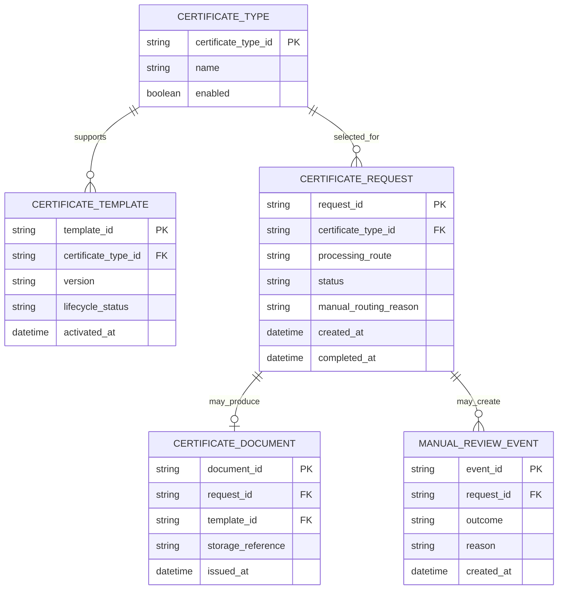

# Digital Certificates — Proposed Conceptual Data Model

**Status:** Portfolio proposal, not a representation of the original production database

## 1. Modeling objective

The proposed model supports certificate-type classification, template coverage, request routing, document issuance, and traceability of the template used.

The model is conceptual. It does not assert that the original GOMP / smart_edu system used these entities, field names, or relationships.

## 2. Entity-relationship diagram

## 3. Entity definitions

| Entity | Purpose | Important considerations |
|---|---|---|
| `CERTIFICATE_TYPE` | Catalogue of requestable certificate types | Enabled types should be explicit; actual catalogue is not available in the source materials |
| `CERTIFICATE_TEMPLATE` | Stores template metadata and lifecycle/version information | Proposed design assumes templates are versioned and mapped to a certificate type |
| `CERTIFICATE_REQUEST` | Tracks the student's request and its route/status | Store a route reason when manual handling is selected |
| `CERTIFICATE_DOCUMENT` | Represents the generated or issued document | The actual file should be stored securely; the data model stores a reference rather than the file itself |
| `MANUAL_REVIEW_EVENT` | Records actions/outcomes on the manual route | Include only if required by the agreed operating model and audit needs |

## 4. Key integrity rules

- A request references one valid certificate type.
- An automated request must resolve to one eligible active template.
- A request should not reference a generated document until document generation succeeds.
- A document generated automatically records the template/version used.
- Access to the request and document must be authorized separately from the existence of the record.

## 5. Design decisions to confirm

- Whether template versions and activation dates need to be stored separately.
- Whether student identifiers are references to an existing student system rather than owned by this feature.
- Whether manual-review events require a separate entity or can be represented by workflow/audit events.
- Which metadata must be retained for audit and how long it should be retained.
- Whether a certificate request can produce more than one document in any supported use case.
