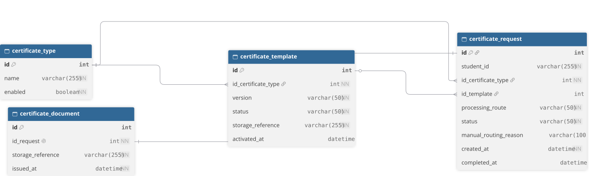

# Digital Certificates — Data Model

## 1. Purpose

This document defines the data model for the digital certificate issuance process.

The ER diagram shows the main entities, their attributes, primary and foreign keys, and relationships. It explains how certificate types, templates, requests, and issued documents are connected within the system.

The data model supports request tracking, template selection, document storage, and certificate issuance.

## 2. Entity-Relationship Diagram

[Open ER Diagram (SVG)](./digital-certificates-data-model-erd.svg)

[View DBML Source](./digital-certificates-erd.dbml)
